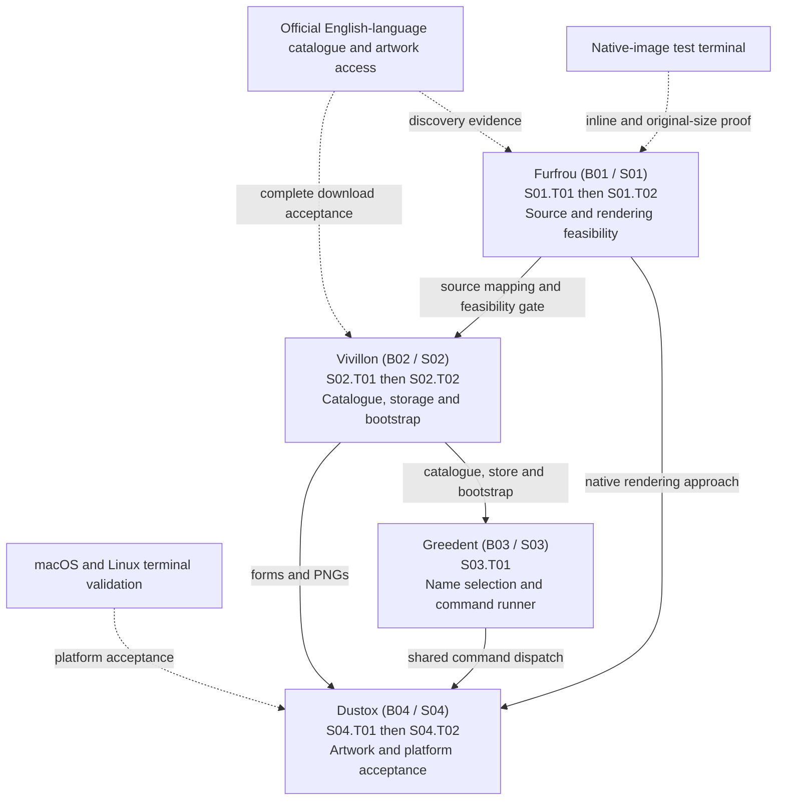

# Pokington implementation plan

## Continuation prompt

```text
Use $jamtat-work to continue Pokington using docs/20261106-implementation-plan.md and docs/20261106-implementation-log.md.

Read applicable instructions, docs/brief.md, docs/20261106-design.md, this plan, the log index, relevant stage logs, Git state, and the latest run permissions. Use the Suggested batches and dependency diagram below. If I have not supplied scope, recommend the first dependency-ready incomplete batch by its Pokémon name, list its exact remaining task IDs, prerequisites, external evidence gaps and stage boundary, and offer it through jamtat-work's concrete quick option. Initially recommend Furfrou (B01: S01.T01, S01.T02), then Vivillon (B02), Greedent (B03), and Dustox (B04) as their dependencies pass. An interrupted batch includes only its remaining tasks; do not repeat completed work or expand beyond explicitly selected scope. Sxx.T00 marks stage completion and is not an implementation task.

Keep the implementation as simple as possible. Use the smallest direct design that meets the accepted command behavior and recovery requirements. Avoid speculative edge cases, general frameworks and defensive filesystem machinery beyond those requirements. Named pipes and similar special-file handling are explicitly outside scope; do not implement or test them. Make this principle a priority in implementation and simplification reviews.

All work must use the existing local main branch in /Users/ben/code/pokington, as explicitly instructed in D21. Verify main before edits; do not ask for branch selection again or create a feature branch/worktree. Preserve unrelated changes. If using main is obstructed by conflicting Git state, explain the blocker before changing that state. The user's 2026-11-07 standing commit/push instruction and Run 03 Q01 explicitly permit committing approved work and pushing origin/main after required checks/reviews, including triggered CI. Honour that current grant rather than repeating a settled publication question; it does not select later scope or authorise PRs, merges or manual CI actions. Consult the latest permission record before publication.

Ask remaining outstanding questions one at a time in plain Markdown. Obtain missing batch/task scope and execution settings. Record exact answers and scoped grants before dependent actions. Preserve valid answers during an interrupted run; completed runs do not grant permissions for later runs. Branch selection is already settled as main.

Follow jamtat-work's continuation procedure and offer a concrete quick option for the selected batch after read-only inspection. Include its exact remaining task IDs and outcomes, continued work on main, implementation/check assignments, each specific correctness and simplification review's scope/model/effort/count, automatic commits after every completed task under the upfront batch approval, stage stop, and the latest authorised publication scope. Preserve the narrower current user rules below rather than assuming the skill's general automatic-action exceptions apply. Honour explicit task-only scope or a valid existing batch selection instead of asking again.

Run implementation sequentially using the selected task's recommended model and effort, subject to the user's run selection. Use one goal per Sxx.Tnn implementation task under the goal procedure below; do not create a stage-wide substitute or attach a token budget unless explicitly requested. Each task requires at least one fresh correctness reviewer using its assigned model/effort, followed by a separate fresh gpt-6.1-sol xhigh simplification and Rust idiom reviewer. Fix findings, rerun relevant checks, show the final commit subject and file-change table, and commit each completed task under the upfront batch approval before completing its goal or starting the next task. Do not ask for separate commit approval.

This prompt and plan alone grant no execution permission; the user's explicit upfront batch approval authorises its listed implementation, agent assignments, specific reviews and per-task commits. Pushes, PRs and manual CI remain separately authorised. Obtain explicit approval for each specific review after offering its scope, model, effort and count, including the separate simplification review. Honour a valid exact review grant already recorded for this run without asking again; plan recommendations or an earlier different review grant are not standing approval. Obtain implementation delegation approval if model selection requires an implementation sub-agent; otherwise use the selected primary model. Upfront approval authorises the whole selected batch, including a coherent commit after every completed task. Before each commit, show its proposed <component>: Sxx.Tnn <brief change> subject and short changes-by-file table, then commit without another approval question. This standing policy applies to each explicitly approved batch and does not authorise unselected scope or publication.

Every implementation commit uses <component>: Sxx.Tnn <brief change>. Include current contract, tracking and log updates in the task commit, let normal hooks run, and fix failures without running pre-commit hooks separately. A failed final task commit blocks starting the next task; fix normal hook failures and retry within the approved scope.

At every stage boundary, report changes, checks and both review results for each task. Include stage integration in the final task's explicitly approved review scopes and commit. Resolve findings and create the final task commit under the upfront batch approval. Continue through only the stages already included in the approved batch; stop at its boundary before unselected work. Valid one-off grants cover only their specified actions. Push approval includes automatically triggered CI; manual CI actions need separate approval.

Maintain separate stage logs with actual UTC timing, exact questions/replies, selected batch and remaining task IDs, scoped permissions, evidence, deviations and publication results. Update the brief when behavior changes, preserve decision history, and link tracking to evidence. Stop for material design changes or missing required evidence. Report completed batch/task IDs, checks, reviews, commits, publication, blockers and the next suggested dependency-ready batch or remaining task. Do not access TOMORROW.md without an explicit request.
```

Date: 2026-11-06. Status: stage sequence and CLI refinements approved with D19 goal/review additions, D20 `jamtat-work` compatibility, and D21 suggested batches/main-only work; no implementation started. Exact implementation and correctness model assignments below are recommendations for run selection; the requested simplification model is `gpt-6.1-sol` at `xhigh`.

## Sources and precedence

- 2026-11-07 native integration correction (D33): the user explicitly instructed “yeah just use ratatui-image to deal with it dont do your own weird shit”. S04.T02 uses standard Picker capability/font detection and library protocol encoding, removing custom terminal/version and SSH restrictions. Standard terminal-response queries replace the prototype's zero-query implementation; retain pipeline guards and restore terminal state. Earlier requirements implying native detection never reads or changes terminal mode are superseded by this explicit library choice. [Run04 Q02](logs/20261107-s04-implementation-log.md#q02--replace-custom-native-detection-with-ratatui-image).

- 2026-11-07 current standing permission: the user requested the next batch with “standing permission to commit and push by yourself”, then approved Run 03 Q01 with “yes do that, that's fine”. The concrete proposal explicitly selects existing main, automatic task commit and push to origin/main after checks/reviews, including triggered CI; no PR. This supersedes earlier no-publication restrictions for the approved work. Batch selection and specific reviews still require upfront approval; later batches remain unselected. [Run 03 Q01](logs/20261107-s03-implementation-log.md#q01--concrete-upfront-batch-proposal).

- 2026-11-07 batch-commit permission: the user instructed “update the prompt to indicate that when i give approval at the start it is for the whole batch including commits after every task”, then “now take that standing permission and finish this batch”. Upfront approval covers the selected batch, including local commits after each completed task. Show each subject/file table and run normal hooks without asking again. This supersedes separate per-commit approval gates, including Run 02 Q04; other scope, review and publication limits remain. [Run 02 Q05](logs/20261107-s02-implementation-log.md#q05--standing-batch-commit-permission-and-resume).

- 2026-11-07 simplicity instruction: “this implementation really should be as simple as possible”, followed by “note that in the implementation plan as a key point”. The user also instructed “don't deal with named pipes or complicated stuff like that. just ignore it”. Simplicity is a key implementation and review requirement across the remaining plan. S02.T01's named-pipe finding is waived by explicit scope decision; do not add that handling or its tests. Required normal-data validation, resumable bootstrap, atomic publication and preservation of the active dataset remain in scope. [Run 02 Q03](logs/20261107-s02-implementation-log.md#q03--prioritise-simple-implementation-and-omit-named-pipe-work).
- 2026-11-07 review assignment revision: the user instructed “downgrade all astra reviews in this stage and the plan to sol xhigh”. All remaining correctness reviews use one fresh `gpt-6.1-sol` `xhigh` reviewer, followed by a separate fresh Sol `xhigh` simplification/Rust reviewer. This supersedes the Astra review recommendations for S02 and S04; implementation assignments and historical completed reviews are unchanged. [Run 02 Q02](logs/20261107-s02-implementation-log.md#q02--replace-astra-reviews-with-sol-xhigh).
- 2026-11-07 unsupported non-battle depictions (D32): exclude exactly Captain Pikachu, Mr. Windychu, Ms. Waveychu, Zygarde Cell and Zygarde Core, retaining source references and reasons. Original species and other supported forms remain required. Q16 authorises one additional targeted correctness follow-up; default illustration identities remain under assessment.
- 2026-11-07 unavailable illustrations (D31): exclude exactly Artisan Poltchageist and Masterpiece Sinistcha after confirmed source 404s and no linked illustration alternatives. Retain their evidence; arbitrary download failures remain fatal.
- 2026-11-07 eligibility decision (D29): the user chose illustration-only entries. Include every original species and all source-linked alternate illustration PNGs; omit variations exposed only as sprites/game renders. This supersedes any earlier requirement to exhaust every canonical or raw API form regardless of illustration availability. Complete discovery/type/identity validation applies to the eligible illustrated set, with no fabricated art, substituted original picture, render fallback or guessed URLs.
- 2026-11-07 exclusions (D30): exclude exactly Rotom Phone, Rotom Drone, Rotomi and Rotom Phone Paldea Ver., whose non-battle device illustrations lack supported types. Preserve other eligible entries and fail on unresolved metadata rather than generalising this exclusion.
- 2026-11-07 selected source (D28): the user selected Serebii's native illustration PNGs after the fresh investigation verified every original species and the 45 newer Mega candidate files. This concludes the Pokémon Database/HOME trial as an unselected visual tier. Source integration continues on Serebii, with illustration-only eligibility now settled by D29, subject to full form/type validation, required reviews and approved commit. No JPEG conversion or source-native 3D-render default.
- 2026-11-06 latest investigation update (D26): following source comparisons, the user requested official-looking PNG artwork for all Pokémon from Pokémon Database and replacement of the existing investigator with a fresh agent. Artwork feasibility work now follows that request; derive all-species coverage from the source and report alternate forms separately. Do not equate small icons or battle sprites with suitable full artwork, silently convert JPEGs, or claim production adoption from sample success. Earlier source attempts and their code/evidence remain historical until a provider passes the gate.
- 2026-11-06 current source update (D25): the user explicitly switched discovery to [Serebii's National Pokédex](https://www.serebii.net/pokemon/nationalpokedex.shtml) after complete main-site access failed. This supersedes this plan's earlier official-only/main-site source constraints, including those in the historical continuation prompt. Apply existing species/form/type/artwork completeness, validation, browser-profile fetching and per-task evidence gates to Serebii. Keep historical source failures; do not repeat official-site tuning by default.
- Current user instructions and scoped permissions govern actions. Upfront batch approval includes per-task commits; specific review scopes/settings must still be approved upfront or separately, and publication remains separate.
- [Brief](brief.md) governs application behavior. [Design decisions](20261106-design.md) record D01–D21 and historical alternatives; rejected proposals are not requirements.
- This plan proposes build order, implementation details, and verification. [Log index](20261106-implementation-log.md) will locate actual work and permission records.
- This plan alone authorises no implementation. Stage-sequence approval is separate from implementation, agent, commit, and publication permissions.
- Execution uses the installed `jamtat-work` skill, its continuation procedure and stage-log template. Its per-task correctness review, separate simplification review and per-task final commit requirements apply. The user's standing batch-commit permission removes separate per-task commit questions. Specific review-launch approval and the selected batch boundary remain in force; show concrete commit proposals before acting. Discussing compatibility does not invoke implementation authority.
- D21 fixes all work to local `main`, superseding earlier branch-choice instructions and the standing feature-branch naming default for this project. Work was already on `main` when checked. D21 alone grants branch-location authority; current commit/push permission is separately recorded in Run 03 Q01.

## Scope and accepted refinements

Build the Rust CLI described in the brief: original species names for `choose`; all source-exposed artwork forms, including Mega Evolutions, for `art`; complete first-run bootstrap and explicit refresh; versioned JSON through `serde`/`serde_json`; local PNGs; and macOS/Linux support. The accepted rendering, form selection, colour, sizing, and failure rules remain unchanged.

The following bounded refinements were accepted with the stage-sequence approval in D19 and are incorporated in the brief:

- `choose` samples uniformly without replacement, accepts repeatable `-e/--exclude`, treats unknown excluded names as no matches, and requires `--count`. Zero requests succeed with no names; negative or malformed counts are argument errors.
- Read supplied files as UTF-8. Invalid encoding fails with the file identified, just as unreadable input does. Complete all exclusion checks and validate sufficient candidates before printing any names.
- Use exit 1 for operational failures and the brief's impossible-selection case; let `clap` report argument errors with exit 2. Keep errors and bootstrap progress on stderr so stdout contains only requested names or artwork.
- Help/version and argument validation do not trigger bootstrap. Data commands trigger initial bootstrap when no completed dataset exists; after a completed installation, missing/corrupt local data is an offline error suggesting explicit bootstrap repair rather than an automatic network update.
- `art` prints inline and exits, leaving the output in the terminal. It is not an interactive full-screen viewer. Explicit widths must be positive integers or `original`; unknown species/forms are errors. Invalid local references or schema versions fail clearly.

Engineering details to settle inside tasks: bounded HTTP concurrency/timeouts/retries, source parsing selectors, source-derived form normalization and collision handling, terminal query limits, resampling filters, and internal module layout. Changes to accepted behavior require a new design decision.

## Repository starting point and reuse

| Capability | Existing evidence | Build/reuse boundary | Owner |
| --- | --- | --- | --- |
| Rust executable | `Cargo.toml`: edition 2024; `src/main.rs`: Hello World | Reuse package scaffold; build all application behavior | S02–S04 |
| Requirements | `docs/brief.md`, D01–D21 | Reuse contract; preserve pre-existing untracked brief and `Cargo.lock` | All |
| Official catalogue | US requests returned anti-bot HTML; regional sample pages expose forms | External integration; prove complete discovery before building against it | S01.T01 |
| Native graphics | Required `ratatui-image`; upstream examples query stdio | Reuse library after proving inline output and pixel sizing | S01.T02, S04.T02 |
| Storage, downloads, selection, text rendering | No reusable application code exists | New project modules; keep boundaries small and testable | S02–S04 |

## Dependencies and feasibility

Suggested batch sequence: **Furfrou → Vivillon → Greedent → Dustox**. Each batch maps to exactly one existing stage, reusing its Pokémon name and unchanged task IDs. B01–B04 remain stable identifiers; the Pokémon names are the primary batch names used in scope recommendations. Batches are scope-selection conveniences, not extra tasks or goals. Implementation tasks and their two review passes run sequentially on `main`. Review-agent launches require specific approval; implementation delegation is not requested by this plan. S01 must establish both external feasibility gates before the application stages begin.

- Source gate (D25): prove complete, discoverable species/form coverage from Serebii's National Pokédex and source-linked pages. Derive catalogue size, form identities and artwork URLs from source data; do not guess an upper Pokédex number or probe suffixes until a request fails. Verify coverage across game generations before adopting a single game-specific detail route. Sample Meowth, a species with distinct Mega forms, dual-type forms, and the newest entries discovered from the source. If Serebii cannot meet required coverage, stop and discuss that concrete gap. Historical official-site attempts remain evidence, not the current sourcing restriction.
- Rendering gate: verify inline output with `ratatui-image`, safe bounded capability queries, terminal restoration, and native 1:1 cropped-image pixel sizing. The [Picker documentation](https://docs.rs/ratatui-image/11.1.0/ratatui_image/picker/struct.Picker.html) describes stdio queries and recommends alternate-screen initialization; an interactive example does not prove the required inline behavior. Do not silently substitute a full-screen UI or resize `original` output.
- Dependencies already requested: `clap`, `reqwest`, `ratatui-image`, `serde`, `serde_json`. Select compatible versions during S01/S02 and record them in Cargo files. Add focused support crates for PNG transforms, standard data directories, progress, sampling and safe storage as needed; avoid inventing a general framework.
- 2026-11-06 update (D24): the user approved testing `wreq` 0.16.3 plus `wreq-util` 0.2.0 instead of reqwest for S01.T01's official-source prototype, because standard browser headers alone did not provide repeatable access. Full crawl, native build and task acceptance remain pending; later transport use must follow the verified result rather than assuming either client passed.

## Suggested batches

Select the first incomplete batch whose prerequisites pass, rather than selecting all remaining work. If some tasks are complete, propose only the unfinished tasks in that batch. Within a selected batch, finish each task's goal, two reviews, checks and approved commit before starting its next task. Stop at its stage boundary for the existing approval process. Explicit smaller scopes remain valid; grouping does not grant implementation or review authority.

| Batch / stage | Suggested task scope, in execution order | Related outcome | Prerequisites | Exit / next recommendation |
| --- | --- | --- | --- | --- |
| **Furfrou (B01 / S01)** | [S01.T01](#s01-t01), [S01.T02](#s01-t02) | Prove the two external integrations before committing to application code | Official English-language metadata/artwork access; a native-image terminal for rendering evidence | Both source and inline/original-size rendering gates pass; then propose Vivillon |
| **Vivillon (B02 / S02)** | [S02.T01](#s02-t01), [S02.T02](#s02-t02) | Build the shared catalogue/store and recoverable download pipeline together | Furfrou complete as a feasibility gate; source mapping from S01.T01 | Complete real bootstrap, recovery evidence and usable offline dataset; then propose Greedent |
| **Greedent (B03 / S03)** | [S03.T01](#s03-t01) | Deliver name selection through the command runner and shared data lifecycle | Vivillon's completed dataset, store and bootstrap | Exclusion/CLI/offline acceptance passes; then propose Dustox |
| **Dustox (B04 / S04)** | [S04.T01](#s04-t01), [S04.T02](#s04-t02) | Share image transforms across text/native renderers and finish platform acceptance | Vivillon's form metadata/PNGs; Furfrou's native rendering approach; Greedent's command dispatch | Both rendering tasks and macOS/Linux evidence pass; report completion |

### Dependency evaluation

- **Inside B01:** source discovery and rendering feasibility do not depend on each other. They share an early decision boundary because either can invalidate the design. The suggested run still executes them sequentially; this independence is not agent delegation permission.
- **B01 → B02:** source identity/normalization evidence is a technical input to metadata/bootstrap. Rendering feasibility is an intentional stage gate rather than a storage-code dependency; retain it to avoid building the application around an unproven rendering requirement.
- **Inside B02:** storage/checkpoints and safe publication must exist before the HTTP/bootstrap task can demonstrate recovery. Do not combine both tasks into one delayed commit.
- **B02 → B03 and B04:** both commands require the same validated local catalogue and bootstrap lifecycle. Artwork also requires the associated PNGs and form records. These are shared data/code dependencies.
- **B03 → B04:** the current task allocation establishes the common command runner and dispatch in S03.T01, which S04 extends. Artwork does not depend on the name-sampling algorithm itself. Removing this edge would require moving the shared CLI foundation into an earlier task; that scope change is not part of this revision.
- **B01 → B04:** native protocol/measurement evidence and the reusable rendering approach from S01.T02 feed S04.T02 directly, even though the suggested batch order already passes through B02/B03.
- **External acceptance:** B01 needs live complete-source discovery and a real native-image terminal; B02 needs full live artwork download; B04 needs actual macOS/Linux terminal results. Missing evidence blocks the owning task even when its code dependencies are ready.

### Batch dependency diagram

Solid arrows show technical inputs or the explicitly labelled feasibility gate. Dashed arrows show external evidence requirements. The diagram describes prerequisites; all work remains sequential and on `main`.



## Models and review order

| Stage and tasks | Implementation recommendation | Correctness recommendation, per task | Separate simplification/Rust review, per task | Reason |
| --- | --- | --- | --- | --- |
| S01; S01.T01, S01.T02 | `gpt-6-astra`, `high` | 1 fresh `gpt-6.1-sol`, `xhigh` | 1 fresh `gpt-6.1-sol`, `xhigh` | Use Astra for uncertain source/protocol investigation; independently challenge its evidence with Sol. |
| S02; S02.T01, S02.T02 | `gpt-6.1-sol`, `xhigh` | 1 fresh `gpt-6-astra`, `high` | 1 fresh `gpt-6.1-sol`, `xhigh` | Multi-file recovery and forced refresh need careful implementation and an independent check of failure invariants. |
| S03; S03.T01 | `gpt-6.1-sol`, `high` | 1 fresh `gpt-6.1-sol`, `xhigh` | 1 fresh `gpt-6.1-sol`, `xhigh` | Bounded selection logic has deterministic tests; separate fresh reviewers still inspect correctness and Rust structure. |
| S04; S04.T01, S04.T02 | `gpt-6.1-sol`, `xhigh` | 1 fresh `gpt-6-astra`, `high` | 1 fresh `gpt-6.1-sol`, `xhigh` | Pixel/cell sizing, alpha and terminal state span multiple renderers and require cross-checking. |

These are project-specific recommendations informed by [official OpenAI model guidance](https://learn.chatgpt.com/docs/models), which positions Astra for the hardest workflows and Sol for repeated, sustained work. They are not measured Rust benchmarks. Both models and the stated efforts are available in this session's agent catalogue. Recheck availability at execution time; do not silently substitute a model or let the implementer serve as its own reviewer. In the user's requested “sol xhigh” pass, Sol means `gpt-6.1-sol` consistently with the existing plan.

Each implementation task receives two distinct fresh reviewers, in order: correctness, then simplification/Rust idioms. Reviewers produce findings rather than edit code. Resolve correctness blockers and pass checks before requesting the simplification pass. The latter examines ownership/borrowing, unnecessary cloning/allocation, error handling, iterator/control-flow clarity, needless abstractions and duplicated code or test setup. Preserve behavior and avoid unrelated redesign. Record every suggestion as accepted, rejected or deferred with a reason; optional stylistic suggestions do not require changes. Apply in-scope changes, rerun affected checks, and request a specifically approved correctness follow-up if the changes require one.

The final task in each stage includes stage composition and exit evidence in its correctness scope, explicitly shown in that review proposal. This provides the independent stage-exit review required by `jamtat-work`; it must not omit either the final task's own review or a prior task's review. Do not add a duplicate stage simplification pass by default. Additional reviewer counts or distinct scopes may be requested by the user, but no unrelated or unspecified review is covered. A concrete quick-option answer may approve explicitly enumerated reviews for the current run; do not re-ask those valid exact grants. It does not provide a blanket grant for later unspecified reviews. Upfront batch approval does include every selected task's final commit; show the concrete subject/file table without seeking permission again.

## Goals for individual tasks

“Step” means an implementation task such as S01.T01, not a stage's T00 completion marker. The user's D19 request selects goal-based execution for these tasks when implementation scope is authorised; it does not start implementation or grant review/commit authority now. [Official goal documentation](https://learn.chatgpt.com/docs/developer-commands#set-or-view-a-task-goal-with-goal) describes a persistent objective attached to the active chat. Tool calls and status handling follow the live goal-tool definitions; goals are progress controls, not permission grants.

1. After batch/task scope, implementation settings and prerequisites are settled, verify the already authorised `main` branch and call `get_goal`. Continue a matching unfinished task goal; never overwrite or mark an unrelated goal complete. Resolve a conflicting unfinished goal with the user.
2. If no unfinished goal exists, call `create_goal` for the selected task's exact ID, Pokémon name, outcome, plan section, acceptance evidence, two ordered review assignments and final approved task commit. Keep the objective under 4,000 characters and point to this plan for details. Do not set `token_budget` without an explicit request. One primary task goal owns implementation and review coordination; do not create separate reviewer goals or overlapping task goals.
3. Work only within approved scope: implementation → checks → specifically approved correctness review → fixes/checks → specifically approved fresh Sol `xhigh` simplification/Rust review → disposition and in-scope fixes → affected checks/correctness follow-up where needed → log/tracking update → concrete task commit subject/file table → final task commit under the upfront batch grant. Do not begin the next task before that commit succeeds.
4. Record the exact objective, any returned identity, status changes, review identities/settings/scopes, actual verification and commit results in the task's stage log. Use `get_goal` on resumption and before closure. Preserve actual evidence when context is compacted.
5. Call `update_goal` with `complete` only after the task's implementation, required external evidence, checks, both independent reviews, findings disposition and final approved commit are complete. Stage T00 is a rollup of completed task goals plus stage-exit evidence and the final task commit; it is not a substitute task goal.
6. If approval or external evidence is pending, leave the task unfinished and request only the missing input, continuing independent authorised work where possible. Do not mark the goal complete, invent evidence or launch an unapproved review. Do not set `paused` without the user's explicit pause request. Follow the live tool's blocking rule: currently `blocked` requires the same impasse for at least three consecutive goal turns with no meaningful independent progress; a resumed blocked goal starts a fresh audit. Waiting for the first answer alone does not meet that threshold. Do not repeat a pending approval request just to fill goal turns.
7. After a task goal is complete, create the next goal only if its task is already inside the selected authorised scope and prerequisites pass. At stage boundaries report and wait for the required next-stage approval. A depleted budget or stopping work does not complete a task. If a budget was explicitly requested, report final token usage returned on completion.

Example objective for the first task when implementation is authorised:

```text
Complete Pokington B01 task S01.T01 — Slowpoke on local main using docs/20261106-implementation-plan.md#s01-t01 and docs/20261106-implementation-log.md: prove complete official English-language species/form discovery, source-derived catalogue totals and form identities, representative validated PNG retrieval, and failure detection. Use gpt-6-astra high for implementation if selected. Pass the task's required evidence/checks, one specifically approved fresh gpt-6.1-sol xhigh correctness review, then one separately approved fresh gpt-6.1-sol xhigh simplification/Rust idiom review. Resolve findings, validate changes, update the stage log/tracking, and create the batch-authorised final S01.T01 commit before completion. This goal covers only S01.T01. After completion, S01.T02 needs its own goal and must already be in approved B01 scope. No unapproved agents, publication or automatic stage crossing.
```

No task goal was created during planning; the planning check returned no active goal. The task-specific outcomes and evidence below, together with the model table, define the other six task goals without adding or renaming tasks.

## Implementation boundaries

- **Keep the implementation as simple as possible.** Prefer direct code and standard library operations. Add an abstraction, state transition, validation or test only when it supports an accepted requirement or a relevant observed failure. Avoid general frameworks and speculative edge-case handling. Named pipes and similar special files are outside scope. Simplification reviews should actively look for unnecessary machinery while preserving the required command and recovery behavior.
- Keep argument parsing/dispatch, catalogue models, official-source parsing, local storage/bootstrap, name selection, common image transforms, text rendering, and native terminal output in separate small modules as useful. `main.rs` assembles them.
- JSON records follow D17. Preserve raw source identifiers separately from descriptive form keys. Validate unique species IDs, unique per-species form keys, valid original references, one or two ordered types, and safe local artwork paths. Do not constrain form categories to a closed enum.
- Store completed metadata and immutable artwork references separately from pending refresh state. Stage downloads to temporary files, validate PNGs before considering them complete, and publish the new catalogue atomically on the same filesystem only after every referenced artwork is ready. Preserve active artwork during forced refreshes.
- Resume matching unfinished downloads from checkpoints; only complete validated files count as reusable. A fresh forced refresh redownloads active assets, while retrying that unfinished forced refresh can reuse its successfully staged downloads. Serialize concurrent bootstrap writers; ordinary commands continue reading the last complete dataset.
- Validate catalogue metadata on load; decode artwork during download validation and when rendering, not every PNG on every `choose` invocation. Missing or corrupt selected artwork produces a clear offline error after initial installation.
- Detect only when terminal I/O is safe. Never query redirected stdout. If native-image capability cannot be established, `auto` falls back; explicit `img` errors. Prefer Unicode blocks when supported, otherwise ASCII; reduce colour depth to terminal capability in automatic colour mode. Keep explicit text colour policy independent of image protocol selection.
- Default fitting and numeric sizing preserve aspect ratio using terminal cell proportions. `original` follows D15 without resampling, even when output overflows. Trim transparent margins before all sizing; handle partial transparency consistently and reject fully transparent images clearly.

## Stage sequence

<a id="s01-t00"></a>
### S01 — Furfrou: prove source and native rendering feasibility

Suggested batch: Furfrou (B01). Prerequisites: selected implementation scope approved; work remains on the already authorised `main` branch; network access to allowed public sources; access to a terminal supporting at least one native image protocol for visual evidence.

<a id="s01-t01"></a>
#### S01.T01 — Slowpoke: prove complete source discovery

- Depends on: no implementation task.
- Work: investigate Serebii's National Pokédex index, source-linked species/form metadata and artwork (D25); validate completeness against source-provided evidence; identify original forms and descriptive keys; sample referenced PNGs. Keep any focused parser prototype reusable, and record endpoints, field meanings, observed coverage and failure detection in the stage log.
- Verify: fixture parsing rejects anti-bot HTML, malformed/partial catalogues, duplicate IDs/keys and missing required references. Capture live full-metadata discovery and representative artwork retrieval without embedding a fixed Pokémon count in application logic.
- Required evidence: source URLs, observed totals derived from source data, base/regional/Gigantamax/distinct-Mega examples and PNG checks. If coverage cannot be established, leave the task incomplete and return for a design decision.

<a id="s01-t02"></a>
#### S01.T02 — Poliwag: prove inline native graphics and original sizing

- Depends on: no implementation task; may use a small local fixture image independently of source extraction.
- Work: prototype inline `ratatui-image` output, native protocol selection and cell/pixel measurements. Establish bounded detection, safe cleanup on errors, and native `original` dimensions. Record the tested terminal/protocol and reusable integration approach.
- Verify: display a known-size cropped PNG inline, confirm dimensions in protocol output and visual output, preserve terminal state, and exit without leaving an alternate screen or waiting for input. Demonstrate safe fallback/error behavior when graphics or usable terminal queries are absent.
- Required evidence: terminal/protocol identity, captured pixel dimensions, manual visual result and recovery result. Do not infer native image support from a half-block fallback. Lack of usable terminal evidence blocks this gate.

Stage exit: both gates have evidence; scoped tests and both reviews for each task pass; S01.T02's correctness review also covers the combined source/rendering feasibility evidence. Each review needs specific approval. Record findings, resolve blockers and complete each approved task commit; S01.T02's final commit includes stage exit records. Pause for S02 approval.

<a id="s02-t00"></a>
### S02 — Vivillon: implement recoverable catalogue bootstrap

Suggested batch: Vivillon (B02). Prerequisites: S01/B01 complete and approval to begin S02. Storage technically uses the source evidence; the full S01 completion requirement also preserves the rendering feasibility gate.

<a id="s02-t01"></a>
#### S02.T01 — Koraidon: implement catalogue and safe local storage

- Depends on: S01.T01 for source mapping and the completed S01/B01 feasibility gate, which includes S01.T02; native rendering code is not a technical storage dependency.
- Work: typed `serde` catalogue, source/form normalization proven in S01, schema validation, platform data directories, immutable artwork references, pending checkpoints and atomic active-catalogue replacement. Keep stores injectable for tests without writing to the real user data directory.
- Verify: JSON round trips, unknown schema rejection, model/reference/path validation, interrupted metadata publication, concurrent writer exclusion, and continued reading of the old complete dataset while staging replacements.
- Required evidence: isolated filesystem tests showing incomplete or failed updates cannot replace or damage active data, including forced artwork replacement.

<a id="s02-t02"></a>
#### S02.T02 — Mr. Rime: implement full bootstrap and explicit refresh

- Depends on: S02.T01 and S01.T01.
- Work: browser-profile `wreq` discovery/downloads (D24/D28 verified transport), bounded retries and concurrency, validated temporary PNGs, resumable checkpoints, full initial completion, refresh/force behavior, and progress bar plus download log on stderr. Support plain progress-bar snapshots and log lines when stderr is not a terminal.
- Verify: local HTTP fixtures exercise initial download, skip/resume, new forms, `--force`, interrupted transfers, invalid PNGs, HTTP errors, source drift and failed refresh rollback. Ensure a retry reuses completed staged downloads and fresh forced refreshes replace all active artwork. Check stdout stays clean.
- Required evidence: deterministic failure/recovery tests and one real-source complete bootstrap. Repeat ordinary data access with networking unavailable; record actual source totals without making them constants.

Stage exit: storage/download tests and a real complete bootstrap pass; both tasks have correctness and simplification/Rust review results and final approved commits. S02.T02's correctness review also covers integrated recovery, publication, source validation and stdout discipline. Its final commit includes stage exit records. Pause for S03 approval.

<a id="s03-t00"></a>
### S03 — Greedent: implement constrained name selection

Suggested batch: Greedent (B03). Prerequisites: S02/B02 complete and approval to begin S03.

<a id="s03-t01"></a>
#### S03.T01 — Palafin: implement `choose` and exclusion errors

- Depends on: S02.T02.
- Work: `clap` command structure, name-only sampling, repeatable case-insensitive explicit exclusions, UTF-8 file reads and case-insensitive substring exclusions. Validate inputs before output and integrate initial bootstrap while keeping help/version offline. Reuse an injected temporary store and deterministic RNG in tests.
- Verify: exact count, no repeats, original names only, exhausted candidates, zero/invalid counts, repeated and unknown exclusions, `MEWTWO` excluding both relevant names, multiple files, missing/unreadable/invalid-UTF-8 input and no partial stdout on input failures. Verify exit codes and one-name-per-line output through the actual command runner.
- Required evidence: selection and CLI tests, an installed-data offline run, and clean stdout when first-run bootstrap emits progress on stderr.

Stage exit: selection/CLI checks and both task reviews pass. S03.T01's correctness review also covers stage acceptance for sampling, exclusions and failure output. Its approved final task commit includes stage exit records. Pause for S04 approval.

<a id="s04-t00"></a>
### S04 — Dustox: implement artwork and complete platform acceptance

Suggested batch: Dustox (B04). Prerequisites: S03/B03 complete, B02 form/artwork data, B01 native-rendering evidence, and approval to begin S04.

<a id="s04-t01"></a>
#### S04.T01 — Honchkrow: implement common image transforms and text rendering

- Depends on: S02.T02 and S03.T01.
- Work: name/ID/form resolution, uniform artwork sampling and exact form filtering, transparent-bound cropping, default/numeric/original sizing, appropriate down/upscaling, coloured and monochrome blocks and ASCII, and `--color` behavior. Reject missing data and fully transparent artwork clearly.
- Verify: synthetic images establish crop bounds, partial-alpha handling, aspect/cell sizing, explicit overflow and no resampling for `original`. Test text output without relying only on large snapshots. Seed selection tests over species with unequal form counts; ensure form filtering uses the same keys as named lookup. Test piped automatic ASCII and explicit colour overrides.
- Required evidence: meaningful image/selection/output tests plus visual examples for original, regional, Gigantamax and distinct Mega artwork. Confirm text renderers preserve structure without colour.

<a id="s04-t02"></a>
#### S04.T02 — Sableye: integrate native output and verify macOS/Linux behavior

- Depends on: S04.T01 and S01.T02.
- Work: integrate proven native renderer, safe automatic protocol selection, ordered fallback, explicit-image errors, pixel/cell sizing, inline output and terminal restoration. Add concise usage documentation to an appropriate dated document or existing project entry point.
- Verify: the matrix below on actual macOS and Linux terminals, including at least one native graphics terminal, a Unicode text terminal, and redirected output. Check default fitting, explicit width, original pixel dimensions, inline persistence, error cleanup and no unexpected terminal queries in pipelines.
- Required evidence: platform/terminal/protocol records and visual/manual results alongside automated command/image tests. Record missing environments as unfinished acceptance, not as passed checks.

Stage exit: final Rust checks, real complete-data offline commands, rendering matrix, both platform results and both reviews for each task pass. S04.T02's correctness review also covers final CLI integration, rendering, regression coverage and platform evidence. Its approved final task commit includes stage exit records. Report completion; publication remains separately scoped.

## Requirement-to-acceptance mapping

| Requirement | Source | Tasks | Required acceptance |
| --- | --- | --- | --- |
| Complete Serebii data, dynamic species/form counts | Brief data; D01, D03, D25 supersedes D06 source restriction | S01.T01, S02.T02 | Full discovery evidence and real bootstrap; no guessed count or suffix range |
| Versioned species/form JSON and per-form types | D08, D17 | S02.T01 | Round trip, reference/schema validation and form type examples |
| Full first run, explicit refresh/force, progress | D05, D07 | S02.T02 | Complete real download; refresh/skip/force tests; bar and log on stderr |
| Resume and preserve old dataset on failure | D09 | S02.T01, S02.T02 | Interrupted initial/forced refresh tests with intact active metadata/artwork |
| Name-only selection and exclusions | Brief choose; D01, D10, D18 | S03.T01 | Count/uniqueness/exclusion tests, exit 1 and empty stdout on failures |
| Named/default/form/random artwork | D01–D04 | S04.T01 | Original default, explicit forms, uniformly sampled entries, empty-filter errors |
| Crop, scaling and original-size mappings | Brief art; D14, D15 | S01.T02, S04.T01, S04.T02 | Pixel/character dimensions, crop/alpha tests and visible 1:1 native proof |
| Modes, fallback, colour and redirection | D12, D13, D16 | S01.T02, S04.T01, S04.T02 | Output/terminal matrix; explicit image errors and colour override checks |
| macOS/Linux and offline ordinary commands | D05, D11 | S02.T02, S03.T01, S04.T02 | Both platform records and network-unavailable installed-data runs |

## Verification and failure coverage

Run `cargo fmt --check`, `cargo test --locked`, and `cargo clippy --locked --all-targets -- -D warnings` for each completed implementation stage once dependencies are locked. Use `cargo build --locked` and actual CLI invocations for final platform acceptance. Repeat checks only after relevant changes or unresolved findings. Unit and integration tests use isolated directories and local HTTP fixtures; ordinary automated tests must not depend on the live official site.

| Environment or failure | Expected behavior |
| --- | --- |
| Native graphics terminal | Auto chooses supported native protocol; explicit img works; sizing matches request |
| Unicode terminal without native images | Auto uses blocks; explicit img errors |
| Minimal/dumb terminal | Auto uses ASCII; no unsafe capability query |
| Redirected stdout | Auto uses 80-column ASCII by default, without control codes; explicit colour/width overrides are respected |
| Missing/redirected stdin or unavailable terminal query | No user-input consumption or unbounded wait; conservative auto fallback or clear explicit-img error |
| Invalid metadata, bot page, truncated data or PNG | Fail validation; do not publish incomplete data |
| Interrupted download, disk/write failure or concurrent bootstrap | Preserve active dataset and completed resumable downloads; no partial file is considered complete |
| Unknown name/form, unreadable exclusion input or insufficient candidates | Clear stderr error, nonzero status, no names printed |

Live-site discovery and manual terminal/platform evidence are external acceptance gates, not replaced by fixture tests. Network availability, source completeness and capable test terminals may require user assistance during the relevant stage. Manual GitHub Actions runs or new publication require explicit approval.

## External prerequisites and exclusions

- Required: Rust toolchain/dependency access, user-selected Serebii source access with complete coverage (D25), and actual macOS/Linux terminal validation. Current partial implementation evidence and remaining gates are recorded in the stage log; do not treat fixture checks or earlier official-site samples as full source acceptance.
- Outside this release: Windows, unofficial data fallbacks, lazy artwork downloads, full-screen interactive UI, and scheduling automatic refreshes. These are scope exclusions, not unfinished required acceptance. No separate TODO file is created.
- Storage cleanup/migrations beyond rejecting unsupported schemas can be designed later; do not remove artwork still referenced by active or pending metadata. Required crash/retry behavior remains in S02.

## Stage and task tracking

Model legend: **Astra** = `gpt-6-astra`; **Sol** = `gpt-6.1-sol`. Efforts are literal `high` and `xhigh`. Each task row specifies implementation plus at least one fresh correctness reviewer and a separate fresh Sol `xhigh` simplification/Rust reviewer, in that order. Models are recommendations for run selection; there is no model-switch or delegation grant here.

Every task has one goal under the procedure above. Its implementation, evidence, required checks, both reviews and resulting validation, and batch-authorised final task commit must finish before the next task begins. The final task's approved correctness scope includes stage integration; T00 requires all its task goals and stage exit records in that final task commit. Each review still needs specific approval, and the user may request more reviewers. If a required review is declined, agree and record a plan revision rather than treating it as passed.

| ID | Done | Stage or task | Implementation | Review | Rationale | Comments |
| --- | --- | --- | --- | --- | --- | --- |
| [S01.T00](#s01-t00) | ✅ | **Furfrou (B01) — feasibility stage completion** | — | Stage integration in S01.T02 correctness; both task review pairs complete | Prevent building against unproven integrations | Both gates and review pairs complete; final 43 tests pass; completed by final S01.T02 commit under Q19; stop before S02 |
| [S01.T01](#s01-t01) | ✅ | Slowpoke — complete source discovery | Astra high | 1 Sol xhigh correctness; then 1 Sol xhigh simplification/Rust | Investigate source data; challenge completeness independently | Complete in `fac6f5e`; D28–D32 applied; correctness/simplification findings resolved; 33 tests/full 1,025-species/1,427-form replay pass; [Run 01 Q17](logs/20261106-s01-implementation-log.md#q17--concrete-s01t01-commit-proposal); goal complete |
| [S01.T02](#s01-t02) | ✅ | Poliwag — inline native graphics and pixel sizing | Astra high | 1 Sol xhigh correctness including S01 integration; then 1 Sol xhigh simplification/Rust | Native dimensions and terminal state need direct evidence | 43 tests, actual Ghostty visual/pixel/recovery and combined stage review pass; N1 resolved, simplification complete/output unchanged; final local commit authorised by [Run 01 Q19](logs/20261106-s01-implementation-log.md#q19--autocommit-instruction-for-the-remaining-batch-task); completed by this final task commit |
| [S02.T00](#s02-t00) | ✅ | **Vivillon (B02) — bootstrap stage completion** | — | Stage integration in S02.T02 correctness; both task review pairs complete | Failed refreshes must preserve working offline data | Both tasks/review pairs and 76 tests/checks pass; real 1,025-species/1,427-form bootstrap and enforced offline proof; completed by final T02 commit under Q05, stop before B03 |
| [S02.T01](#s02-t01) | ✅ | Koraidon — catalogue and safe local storage | Sol xhigh | 1 Sol xhigh correctness; then 1 Sol xhigh simplification/Rust | Independently check metadata/artwork recovery invariants | Complete in `a3416f0`; 64 tests/checks, both reviews and simplifications complete; N1 excluded by Q03; goal complete |
| [S02.T02](#s02-t02) | ✅ | Mr. Rime — full bootstrap and refresh | Sol xhigh | 1 Sol xhigh correctness including S02 integration; then 1 Sol xhigh simplification/Rust | Cross-check HTTP, retries and publication together | 76 tests/checks, complete real bootstrap, enforced offline proof, no-blocker correctness/stage review and separate simplification complete; final commit under Q05 closes B02 |
| [S03.T00](#s03-t00) | ✅ | **Greedent (B03) — selection stage completion** | — | Stage integration in S03.T01 correctness; task review pair complete | Validate exclusions and output independently | 87 tests/checks, real-data network-denied acceptance and both reviews pass; completed by final T01 commit under Run 03 Q01; stop before B04 |
| [S03.T01](#s03-t01) | ✅ | Palafin — choose and exclusions | Sol high | 1 Sol xhigh correctness including S03 integration; then 1 Sol xhigh simplification/Rust | Bounded behavior with deterministic tests and two fresh perspectives | Product bootstrap/force and choose complete; correctness/stage review no blockers, separate simplification no useful findings; final task commit/publication under [Run 03 Q01](logs/20261107-s03-implementation-log.md#q01--concrete-upfront-batch-proposal), final result in its linked receipt |
| [S04.T00](#s04-t00) |  | **Dustox (B04) — artwork and platform stage completion** | — | Stage integration in S04.T02 correctness; both task review pairs required | Native/text output and platform evidence need cross-checking | T01 complete in 563a162; T02 implemented/automated checks pass; actual native visual result and T02 reviews pending |
| [S04.T01](#s04-t01) | ✅ | Honchkrow — transforms and text rendering | Primary session directly under Run04 Q01 | 1 Sol xhigh correctness; then 1 Sol xhigh simplification/Rust | Check shared pixel/cell/alpha semantics and idiomatic Rust | Checks/offline examples and both reviews pass; completion effective at final task commit; [Run04](logs/20261107-s04-implementation-log.md) |
| [S04.T02](#s04-t02) |  | Sableye — native output and platform acceptance | Primary session directly under Run04 Q01 | 1 Sol xhigh correctness including S04 integration; then 1 Sol xhigh simplification/Rust | Confirm terminal state, output dimensions and platform behavior | D33 library implementation/code reviews complete;104 working-tree tests pass on macOS/Linux. Q06 explicitly authorises commit/push despite the incomplete native visual gate; acceptance stays incomplete. [Run04](logs/20261107-s04-implementation-log.md) |
